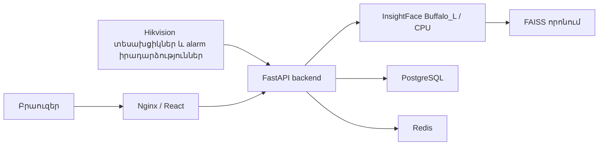

# Face Analytics Pro․ նախագիծը և այլ համակարգչում տեղադրելու ուղեցույց

Պահոց՝ **https://github.com/gevorgsc/face-analytics-deploy**  
Մոդելներ, Linux SDK և աշխատող վեբ տարբերակ՝ **Releases → deployment-v1**։  
Տեղափոխման փաթեթի պատրաստում՝ **2026-10-21**։

## 1. Ինչ ծրագիր է

Սա սերվերի վրա աշխատող **Face Analytics Pro** հավելվածն է՝ Hikvision տեսախցիկներից
ստացվող դեմքերի ու իրադարձությունների վերլուծության, մարդկանց որոնման, ներկայության,
հաշվետվությունների և հատակագծի համար։ Ծրագրից օգտվում են բրաուզերով։

Այս repo-ն առանձին է `gevorgsc/detect-deploy` նախագծից։ Այն Windows-ի GPU-ով կմախք,
կեցվածք և ակտիվություն մշակող նախորդ ծրագրի պատճենը չէ։ Այստեղ հիմնական դեմքի
մոդելը **Buffalo_L / InsightFace** է, իսկ սերվերի գործարկումը CPU-ով է։

Գործառույթների հիմնական խմբերը՝

- Տեսախցիկներ, ուղիղ պատկեր, SDK/ISAPI/RTSP և Hikvision alarm իրադարձությունների ընդունում։
- Դեմքի հայտնաբերում, ճանաչում և FAISS-ով նման դեմքերի որոնում։
- Մարդկանց գրանցում, նկարով որոնում, իրադարձությունների պատմություն և ֆիլտրեր։
- Մասնաճյուղեր, տեսախցիկների տեղադրում հատակագծի վրա և մարդկանց անցումների ցուցադրում։
- Ներկայություն, ժամանակային կանոններ, հաշվետվություններ և արտահանումներ։
- Օգտատերեր, դերեր, թույլտվություններ և գործողությունների գրանցամատյան։
- Աղբյուրում առկա են նաև Access Controller/ACS, այցելուների և ձեռնարկատիրական այլ
  բաժինների մոդուլները։ Դրանց օգտագործումը կախված է համապատասխան լիցենզիայից ու
  սարքերի կարգավորումից։ Լռելյայն տեղադրումը սերվերի **face_analytics** տարբերակն է։

Կոնկրետ տեսարանի ճանաչման որակն ու նոր համակարգչի թողունակությունը պետք է չափել տեղում։

## 2. Ինչ բաղադրիչներից է կազմված

Սերվերի գործող տեղադրումը Docker Compose-ով աշխատող չորս հիմնական ծառայություն ունի՝

| Ծառայություն | Դեր |
|---|---|
| `backend` | FastAPI, Python, դեմքերի մշակում, API, օգտատերեր և բիզնես տրամաբանություն |
| `frontend` | React ինտերֆեյս՝ մատուցվող Nginx-ով |
| `postgres` | PostgreSQL 16՝ հիմնական տվյալների բազա |
| `redis` | Redis 7՝ արագ օժանդակ վիճակ, սահմանափակումներ և հաղորդակցման օժանդակություն |



Նույն սերվերում աշխատող Telegram/catalog բոտը առանձին ծրագիր է։ Այս analytics
տեղադրման համար այդ բոտի կոդը, տվյալները և ծառայությունները պետք չեն։

## 3. Ինչն է տեղափոխվել և ինչպես է ստուգվել

Փաթեթը պատրաստվել է աշխատող ծառայությունները չկանգնեցնելով և սերվերի ծրագրային
ֆայլերը կամ տվյալները չփոփոխելով։

- Գործող backend-ի 131 application/migration/tool Python ֆայլերը համեմատվել են
  սկավառակի աղբյուրի հետ․ դրանք համընկնում էին։
- Repo-ում պահպանված են սկզբնական backend Python ֆայլերի ճշգրիտ բայթերը։
- Գործող կոնտեյներից վերցվել են օգտագործվող **Linux SDK-ն և հինգ Buffalo_L ONNX մոդելները**։
- Վեբ կոնտեյների **1624 պատրաստ frontend ֆայլերը** առանձին ստուգվել են SHA-256-ով։
- Frontend-ի խմբագրվող React աղբյուրները նույնպես ներառված են։
- Կան սկզբնական Python կախվածությունների ցանկը, ֆիքսված տարբերակները, համակարգի
  նկարագրությունն ու պաշտոնական Docker image-ների digest-ները։
- Backend-ի **189**, frontend-ի **27** թեստերն անցել են, իսկ frontend-ը հավաքվել է աղբյուրից։
- Առանձին դատարկ SQLite փորձնական տեղադրմամբ անցել են bootstrap-ը, առաջին admin-ի
  ստեղծումը, `/health`/`/ready` ստուգումները և պատճենված մոդելների իրական CPU կանչը։
  Առանց լիցենզիայի պաշտպանված API-ի 402 պատասխանը նույնպես հաստատվել է։

Փաթեթի և հետագա տեղադրման ստուգման ֆայլերն են՝

- `source-code-manifest.json`՝ սկզբնական backend Python ֆայլերի SHA-256-ները։
- `assets-manifest.json`՝ SDK-ի, մոդելների և պատրաստ frontend-ի անդամների չափերն ու SHA-256-ները։
- `source-runtime.json`՝ սկզբնական գործարկման Python/փաթեթների/կոնտեյների տեղեկությունները։
- `VERIFICATION.json`՝ պատրաստման վերջնական ստուգումների արդյունքները։
- `scripts/verify_package.py`՝ բացված տեղադրման ֆայլերի ամբողջականության ստուգում։
- `scripts/verify_running.py` և `backend/verify_runtime.py`՝ նոր գործարկման ստուգում։

## 4. Ինչը չի հրապարակվում

Հանրային repo-ում չկան արտադրական `.env` արժեքներ, գաղտնաբառեր, JWT/Redis/PostgreSQL
բանալիներ, տեսախցիկների մուտքային տվյալներ, private լիցենզավորման բանալի, գործող
տեղադրման լիցենզիա, մարդկանց բազա, գրանցված embedding-ներ, նկարներ, պատմություն,
տվյալների բազայի dump-եր, backup-ներ և աշխատանքային log-եր։

Նոր տեղադրումը ստեղծում է **նոր դատարկ բազա և նոր admin օգտատեր**։ Տեսախցիկները,
մարդիկ, հատակագիծը, կազմակերպության կանոններն ու ինտեգրացիաները լրացվում են նորում։
Ընդհանուր pretrained մոդելների քաշերը ներառված են․ դրանք մարդկանց գրանցված բազան չեն։

## 5. Նոր համակարգչի պահանջները

Աջակցվող տեղափոխման տարբերակը **Linux x86_64 Docker կոնտեյներներով** գործարկումն է։
Հնարավոր հոսթերը՝

1. Linux x86_64 համակարգիչ/սերվեր՝ Docker Engine և Docker Compose plugin-ով։
2. Windows x64՝ Docker Desktop-ի **Linux containers** ռեժիմով և աշխատող WSL2/վիրտուալացմամբ։

Փաթեթում Linux `.so` SDK կա։ Windows-ի վրա անմիջապես Python-ով ամբողջ հավելվածը
գործարկելու համար պետք է առանձին Windows SDK և այդ տարբերակի առանձին ստուգում։
Այս repo-ի ստուգված տեղափոխման ուղին Docker-ն է։

Հոսթում պետք է նաև Python 3.11 կամ նոր՝ ներբեռնման/կարգավորման ստանդարտ գործիքների համար։
Backend-ի Python-ը կոնտեյների ներսում առանձին՝ 3.11 շարքի ֆիքսված տարբերակ է։

NVIDIA GPU պարտադիր չէ․ սկզբնական սերվերը գործարկել է CPU տարբերակը՝ 8 տրամաբանական
պրոցեսորով։ Նոր սարքի նվազագույն RAM-ը կամ տեսախցիկների առավելագույն քանակն այս
տեղափոխման ընթացքում չեն չափվել։ Ստուգեք հասանելի RAM-ը, CPU-ն, սկավառակը և տեսախցիկների
ցանցային հասանելիությունը։ Docker image-ները, Python փաթեթները, մոդելները և հետագա
նկարների պահպանումը հավելյալ սկավառակային տեղ են պահանջում։

## 6. Docker-ի և Python-ի նախապատրաստում

Docker-ի տեղադրման ընթացիկ պաշտոնական քայլերը՝

- Ubuntu՝ https://docs.docker.com/engine/install/ubuntu/
- Windows Docker Desktop՝ https://docs.docker.com/desktop/setup/install/windows-install/
- Python՝ https://www.python.org/downloads/

Windows-ում Docker Desktop-ը պետք է գործարկված լինի և օգտագործի Linux կոնտեյներներ։
Եթե WSL2-ը կամ վիրտուալացումը դեռ չեն միացված, նախ ավարտեք Docker-ի պաշտոնական
նախապատրաստումը․ որոշ փոփոխություններ կարող են վերագործարկում պահանջել։

Հոսթում ստուգել՝

```text
docker version
docker compose version
python --version
```

Linux-ում Python հրամանը սովորաբար `python3` է, Windows-ում՝ `py -3.11` կամ `python`։
Ստորև `python`-ի տեղում օգտագործեք ձեր աշխատող տարբերակը։ Եթե Docker-ը թույլտվություն
է պահանջում, օգտագործեք տվյալ համակարգի կարգավորված Docker հասանելիությունը։

## 7. Repo-ն ստանալը

Git-ով՝

```text
git clone https://github.com/gevorgsc/face-analytics-deploy.git
cd face-analytics-deploy
```

Կամ բրաուզերում ընտրել **Code → Download ZIP**, բացել այն մշտական պանակում և
Terminal/PowerShell-ը բացել հենց այդ պանակում։ GitHub հաշվի մուտք և Git LFS պետք չեն։

Մի գործարկեք ծրագիրը ZIP-ի ներսից։ Repo-ի արմատում պետք է լինեն `compose.yml`,
`Dockerfile`, `backend`, `frontend`, `scripts` և այս ուղեցույցը։

## 8. Մոդելների և SDK-ի ներբեռնում, նոր գաղտնիքների ստեղծում

Տեղային օգտագործման համար՝

```text
python scripts/setup.py
```

Եթե ծրագրից օգտվելու են նաև այլ LAN համակարգիչներ, տալ հենց **նոր համակարգչի** հասցեն՝

```text
python scripts/setup.py --host 192.168.1.50
```

`192.168.1.50`-ը օրինակ է․ այն փոխարինեք նպատակային համակարգչի իրական LAN IP-ով։
Հրամանը երկու հիմնական աշխատանք է կատարում՝

1. Հանրային release-ից բեռնում և ստուգում է մոդելները, SDK-ն ու գործող frontend-ի պատճենը։
2. Ստեղծում է տեղային `.env` և `backend/.env`՝ նոր պատահական գաղտնիքներով։

Արդեն գոյություն ունեցող `.env` ֆայլերը պահպանում է։ Նոր JWT, camera encryption,
PostgreSQL, Redis, admin և alarm բանալիները չեն տպվում հրամանի ելքում։ Admin-ի սկզբնական
գաղտնաբառը տեղում գտնվում է `backend/.env`-ի `DEFAULT_ADMIN_PASSWORD` դաշտում։

Լռելյայն պորտերը՝

- Վեբ ինտերֆեյս՝ **8081**։
- Backend-ի տեղային ախտորոշման պորտ՝ **127.0.0.1:8001**։
- PostgreSQL/Redis-ը հասանելի են Compose-ի ներքին ցանցում։

Սա թույլ է տալիս նույն համակարգչում պահել նաև նախորդ Detect ծրագիրը, որը `8000` է
օգտագործում։ Այլ պորտեր կարելի է տալ առաջին կարգավորման ժամանակ՝

```text
python scripts/setup.py --host 192.168.1.50 --frontend-port 8082 --backend-port 8002
```

Եթե `.env`-ն արդեն ստեղծված է, փոխեք արժեքները հենց տեղում։ `ALLOWED_ORIGINS`-ը պետք է
ներառի բրաուզերում օգտագործվող նույն scheme/host/port-ը, իսկ `ALLOWED_HOSTS`-ը՝ hostname-ը։

## 9. Ինչ փաթեթներ են բեռնվում

| Release asset | Պարունակություն |
|---|---|
| `face-analytics-models-sdk-v1.zip` | 5 Buffalo_L ONNX մոդել և օգտագործվող Linux SDK-ի բոլոր ֆայլերը |
| `face-analytics-frontend-live-v1.zip` | Սերվերում մատուցվող պատրաստ frontend-ի 1624 ֆայլերը |

Մոդելների/SDK-ի փաթեթը մոտ 287 MiB է, պատրաստ frontend-ինը՝ մոտ 14 MiB։
Սա չի ներառում Docker image-ների ու Python կախվածությունների ներբեռնման չափը։

Բացված հասցեները՝

- `backend/.insightface/models/buffalo_l/`՝ ընդհանուր դեմքի մոդելներ։
- `backend/SDK/lib/` և `backend/SDK/lib/HCNetSDKCom/`՝ Linux native գրադարաններ։
- `frontend/runtime-dist/`՝ գործող վեբ տարբերակի պատճեն։
- `.downloads/`՝ բեռնված ZIP-երի քեշ։

Եթե ավտոմատ ներբեռնումը չի աշխատում, Releases-ի `deployment-v1` էջից նույն անուններով
երկու ZIP-ը ձեռքով դրեք `.downloads/` պանակում և նորից գործարկեք `setup.py`։
Դրանք նախապես ձեռքով բացել պետք չէ։

## 10. Ֆայլերի պարտադիր ստուգումը՝ մինչև build-ը

```text
python scripts/verify_package.py
```

Սա ստուգում է սկզբնական backend Python ֆայլերն ու SDK/մոդել/frontend բոլոր բացված
ֆայլերը։ Եթե կան `missing` կամ `changed` տողեր, մի անցեք լուռ առաջ․ նախ ուղղեք բացակայող
կամ սխալ ֆայլերը։ Եթե աղբյուրը ինքներդ դիտավորյալ փոփոխել եք, `changed`-ը կարող է
նշանակել հենց ձեր փոփոխությունը․ manifest-ը սկզբնական սերվերի պատճենի համեմատության համար է։

`.gitattributes`-ը պահպանում է ֆայլերի սկզբնական line ending-ները։ Այն մի ջնջեք․ մի քանի
Python ֆայլերի CRLF/LF փոխելը կարող է hash-ի տարբերություն տալ՝ առանց իմաստային փոփոխության։

## 11. Կառուցում և առաջին գործարկում

```text
docker compose -f compose.yml config --quiet
docker compose -f compose.yml up -d --build
docker compose -f compose.yml ps
docker compose -f compose.yml logs -f backend
```

Առաջին build-ը ներբեռնում է image-ներ և Python փաթեթներ, հետևաբար կարող է ժամանակ տևել։
Backend-ը դատարկ PostgreSQL-ում ստեղծում է ամբողջ schema-ն և նշում Alembic-ի ընթացիկ
տարբերակը, հետո ստեղծում առաջին admin-ին։

`logs -f` դիտարկումը փակել Ctrl+C-ով․ ծառայությունները շարունակում են աշխատել։
Երբ backend-ը healthy է, բացել՝

**http://localhost:8081**

LAN մյուս համակարգչից՝ `http://ՆՈՐ_ՀԱՄԱԿԱՐԳՉԻ_IP:8081`։ Անհրաժեշտության դեպքում
տեղային firewall-ում թույլատրել ընտրված վեբ պորտը ձեր վստահելի ցանցի համար։

## 12. Գործարկումից հետո պարտադիր ստուգումը

```text
python scripts/verify_running.py --url http://localhost:8081 --models
```

Ստուգվում են Compose-ի կազմաձևը, ծառայությունների վիճակը, frontend-ը, `/health`,
`/ready`, backend-ի ներսի մոդելների ու SDK-ի ֆայլերը, Linux գրադարանների բեռնումը,
FAISS-ը և ընդհանուր դեմքի մոդելի կանչը դատարկ կադրով։ Հրամանը տեսախցիկներին չի մտնում
և որևէ սարք չի կառավարում։

Միայն HTTP 200-ը բավարար չէ․ գործիքը ստուգում է նաև `status`-ի իմաստային արժեքը։
Օրինակ `/ready`-ը կարող է HTTP 200 վերադարձնել, բայց ներսում ունենալ `not_ready`։

## 13. Admin մուտքը և լիցենզիան

Մուտքանունը **admin** է։ Գաղտնաբառը վերցնել նոր համակարգչի `backend/.env`-ի
`DEFAULT_ADMIN_PASSWORD` դաշտից։ Նախորդ սերվերի admin գաղտնաբառը այստեղ չի օգտագործվում։

Ծրագիրն ունի իրական լիցենզավորում։ `LICENSE_ENFORCEMENT=1`-ը պահվում է միացված։
Նոր տեղադրումը ստանում է նոր **Installation ID**, հետևաբար նախկին տեղադրման license.json-ը
չի փոխանցվում։ Առանց վավեր `face_analytics` լիցենզիայի համապատասխան բաժինները կարող են
վերադարձնել **402 LICENSE_REQUIRED**․ դա բացակայող մոդելի կամ սխալ գաղտնաբառի նշան չէ։

Սովորական քայլերը՝

1. Բացել launcher/լիցենզավորման բաժինը և վերցնել նոր Installation ID-ն։
2. Ծրագրի սեփականատիրոջից/թողարկողից ստանալ այդ ID-ի համար ստորագրված լիցենզիա։
3. Այն ակտիվացնել ինտերֆեյսով։
4. Ստուգել, որ `face_analytics` մոդուլը վավեր է, հետո անցնել տեսախցիկներին։

Repo-ում կա public verification key-ն, բայց private issuer key-ն չի հրապարակվում։
Արտադրական բանալին կամ license.json-ը հանրային repo-ում ավելացնել պետք չէ։

## 14. Անկախ նոր issuer՝ եթե հենց դուք եք թողարկողը

Եթե ստեղծում եք ձեր սեփական անկախ տեղադրումն ու լիցենզիաների թողարկումը, source-ում
առկա է օրինական keygen/issue գործիքը։ Այն չի անջատում լիցենզավորման ստուգումները։
Բանալիները պահել միայն `.local-license/` տեղային պանակում։ Օրինակ Linux-ում՝

```text
python3 -m venv .issuer-venv
.issuer-venv/bin/python -m pip install cryptography==48.0.1
.issuer-venv/bin/python backend/tools/license_admin.py keygen --private-key .local-license/issuer_private.pem --public-key .local-license/issuer_public.pem
```

Windows-ում նույն գործիքի Python հասցեն `.issuer-venv\Scripts\python.exe` է։
Նոր public key-ն պատճենել `backend/license_public_key.pem`-ի տեղում և backend image-ը
նորից կառուցել, որպեսզի ծրագիրը ստուգի հենց այդ issuer-ի ստորագրությունները։

Այնուհետև նոր տեղադրման ID-ով՝

```text
.issuer-venv/bin/python backend/tools/license_admin.py issue --private-key .local-license/issuer_private.pem --installation-id NEW_INSTALLATION_UUID --customer "Local deployment" --modules face_analytics --output .local-license/license.json
```

Ստացված լիցենզիան տեղադրել UI-ով։ Մի փոխարինեք արդեն գործող issuer-ի բանալիները
առանց դա դիտավորյալ որոշելու․ հին ստորագրությունները նոր public key-ով չեն անցնի։
Մինչև image-ի rebuild-ը եղած public key-ն փոխելը գործող կոնտեյների ներսի բանալին չի փոխում։

`license_server/`-ում նաև activation-code սերվերի աղբյուրն է, իսկ `backend/tools/`-ում՝
կառավարման CLI/GUI գործիքները։ Դրանք առկա են, բայց աղբյուր սերվերի գործող չորս-ծառայությամբ
Compose տեղադրման համար առանձին activation ծառայություն չի մեկնարկվում։

## 15. Տեսախցիկների և իրական աշխատանքի ստուգում

Լիցենզիայից հետո UI-ում ավելացնել իրական տեսախցիկները՝ IP, պորտ, ալիք, մուտքանուն,
գաղտնաբառ և ընտրված կապի տեսակ։ Ստուգել SDK/ISAPI/RTSP հասանելիությունը նոր հոսթից։
Hikvision alarm push-ի դեպքում սարքում նշել հենց **նոր** համակարգչի ընդունման հասցեն
և նոր տեղադրման alarm API key-ի կարգավորումը։ Հին սերվերի բանալին չօգտագործել։

Ստուգումների հերթականություն՝

1. Մեկ տեսախցիկի snapshot և ուղիղ պատկեր։
2. Իրական նոր իրադարձության ընդունում և դեմքի հայտնաբերում։
3. Փորձնական անձի գրանցում, հետո ճանաչում և նկարով որոնում։
4. Օրվա իրադարձություններ, ֆիլտրեր և հաշվետվությունների արտահանում։
5. Մասնաճյուղ, հատակագիծ և տեսախցիկների կետերը նոր կոնֆիգուրացիայում։
6. CPU/RAM, սկավառակի աճ և մի քանի տեսախցիկի միաժամանակյա աշխատանք։

Այս քայլերը ֆայլերի ամբողջականության ստուգումից առանձին են․ կոնկրետ սարքի կապն ու
տեսարանի ճշտությունը միայն տեղում կարելի է հաստատել։ Նախորդ սերվերի կոնֆիգուրացիան
այս տեղափոխման ընթացքում չի փոխվել, ուստի սարքի push հասցեն փոխելը պլանավորեք գիտակցաբար։

## 16. Պատրաստ frontend-ը և աղբյուրից նոր build-ը

Լռելյայն `Dockerfile.frontend.snapshot`-ը վերցնում է սերվերի պատրաստ UI պատճենը։
React աղբյուրը խմբագրելուց հետո օգտագործել source build-ի override-ը՝

```text
docker compose -f compose.yml -f compose.frontend-source.yml up -d --build frontend
```

Այստեղ օգտագործվում է `Dockerfile.frontend`-ը և `VITE_PRODUCT_MODULE=face`-ը։
Առանց override-ի միայն `frontend/src` փոխելը պատրաստ snapshot-ը չի վերակառուցում։
Աղբյուրի build/unit tests-ը ձեռքով, եթե Node.js 24-ն ու npm-ը կան՝

```text
cd frontend
npm ci
npm run build
npm run test:unit
```

Production source build-ի face ռեժիմը տրված է Docker build arg-ով․ առանձին command line
build-ի դեպքում նույնպես սահմանել `VITE_PRODUCT_MODULE=face` միջավայրի փոփոխականը։

## 17. Պահպանում, վերագործարկում և թարմացում

```text
docker compose -f compose.yml restart
docker compose -f compose.yml down
docker compose -f compose.yml up -d
```

`down`-ը պահպանում է named volume-ները։ Տվյալները պահելու համար մի օգտագործեք `down -v`։
Volume-ներում գտնվում են PostgreSQL/Redis տվյալները, նկարները, արտահանումները, backup-ներն
ու runtime/լիցենզիայի վիճակը։ Թարմացումից առաջ պահել դրանց և տեղային `.env`-երի backup-ը։

Կոդի թարմացումից հետո, որպես տեղային պահպանված կարգավորումներով build՝

```text
docker compose -f compose.yml up -d --build
python scripts/verify_running.py --models
```

Հին տվյալներով բազաների վրա աշխատում են Alembic migration-ները, իսկ նոր դատարկ բազայի
համար կա `bootstrap_database.py`-ը։ Արտադրական պատմության պատճենը այս repo-ի մաս չէ։

## 18. Տարածված խնդիրներ

| Ախտանիշ | Ստուգում |
|---|---|
| `docker`/`docker compose` չկա | Docker-ի տեղադրում, daemon, Windows-ում Linux containers ռեժիմ |
| SDK `.so` չի բեռնվում | Linux amd64 կոնտեյներ, ամբողջ SDK պանակը, ֆայլերի իրավունքները և image rebuild |
| Մոդելները պակասում են | `setup.py`, `.downloads` ZIP-երը և `verify_package.py` |
| SHA-256 mismatch | Հեռացնել միայն վնասված ZIP-ը `.downloads`-ից, նորից բեռնել |
| Admin մուտքը չի անցնում | Նոր `backend/.env`-ի գաղտնաբառը, ոչ հին սերվերինը |
| `402 LICENSE_REQUIRED` | Նոր Installation ID-ի վավեր face_analytics լիցենզիա |
| `not_ready` | `/ready`-ի դաշտերը, սկավառակի ազատ տեղը, գրելու իրավունքները և config errors |
| DB/Redis կապի սխալ | `.env`-երը, Compose healthcheck-երը, նույն named volume-ի նախկին գաղտնաբառը |
| Կոդը փոխվել է, UI-ն հին է | Snapshot/source build override-ի ընտրություն և browser cache |
| Պորտը զբաղված է | Ընտրել այլ frontend/backend պորտեր և համապատասխան origin/host կարգավորումներ |
| Camera login/stream խնդիր | Ցանց, ալիք, SDK/HTTP/RTSP պորտ, ճիշտ մուտքային տվյալներ |
| CORS/cookie/CSRF սխալ | Նույն browser origin, `ALLOWED_ORIGINS`, `ALLOWED_HOSTS`, scheme և պորտ |
| CPU/RAM ծանրաբեռնվածություն | Տեսախցիկների/իրադարձությունների քանակ, worker-ներ, մոդելի չափեր և հոսքեր |

## 19. Ինչն է մնում ստուգել նպատակային համակարգչում

Փաթեթի պատրաստման Windows համակարգչում Docker/WSL չկար։ Այնտեղից նոր Linux Compose
stack չի մեկնարկվել, իսկ արտադրական սերվերում թեստային նոր ծառայություններ չեն
տեղադրվել։ Փոխարենը կատարվել են source/runtime համեմատությունները, unit/API թեստերը,
frontend build-ը և փաթեթի manifest-ների ստուգումները։

Նոր համակարգչում պարտադիր ավարտել Docker build-ը, `verify_package.py` և
`verify_running.py --models` քայլերը, լիցենզավորումը և իրական տեսախցիկների փորձարկումը։

## 20. Ինչ ուղարկել Codex-ին նոր համակարգչում

> Տեղադրիր https://github.com/gevorgsc/face-analytics-deploy ծրագիրն այս համակարգչում։
> Նախ կարդա PROJECT_AND_INSTALLATION_HY.md և INSTALL_HANDOFF.md։ Ստուգիր Docker/Linux
> amd64 միջավայրը, ներբեռնիր մոդելներն ու SDK-ն, ստեղծիր նոր տեղային գաղտնիքները,
> ստուգիր բոլոր ֆայլերը, գործարկիր Compose-ը և անցիր verify_running.py --models-ը։
> Օգնիր նոր Installation ID-ի լիցենզավորման ու տեսախցիկների կարգավորման փուլերում։
> Նախկին մարդկանց, պատմությունն ու արտադրական գաղտնիքները մի տեղափոխիր հանրային repo-ով։

